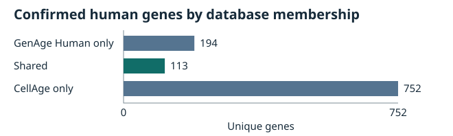

# AI & Longevity: Exploring Genes Associated with Human Aging

**Completed v1.1** · Descriptive research and evidence review

**Experimental v2.0 · Phase 7A** evaluates fibroblast RNA-seq in two cohorts. Of the 113 shared genes, 109 could be tested in both. Their cross-cohort signal did not exceed the matched control benchmark. Ridge predicted chronological age better than constant predictions within discovery, with errors comparable to expression-matched random panels. [Frozen protocol](docs/phase7_research_protocol.md), [data and prior work](reports/phase7_data_feasibility.md), [baseline results](reports/phase7_baseline_results.md)

> Which human genes are represented in both the GenAge Human and CellAge databases, and which biological processes are associated with these genes?

This independent reproducible reanalysis and evidence review compares two Human Ageing Genomic Resources (HAGR) exports. GenAge Human curates candidates for human aging and can draw on model-organism evidence. CellAge curates perturbation experiments on cellular senescence in human cells. Comparing them shows where these kinds of evidence overlap and lets readers trace selected records to the underlying experiments.

- [Research report v1](reports/research_report_v1.md) covers the methods, results, evidence and limitations for academic review.
- [One-page research brief](reports/research_brief.md) summarizes the study for prospective internship supervisors.
- [Related work](docs/related_work.md) compares the published overlap, documents the limits of gene-by-gene verification and outlines a follow-up.

## v1.1 results

| Measure | Result |
| --- | ---: |
| Confirmed GenAge Human / CellAge genes | 307 / 865 |
| Shared genes | 113 |
| GenAge Human only / CellAge only | 194 / 752 |
| Union | 1,059 |
| Jaccard similarity | 0.106704 |
| CellAge records linked to shared genes | 125 |
| Shared genes with direct GO Biological Process annotations | 113 / 113 |
| Distinct direct positive terms, all eligible codes / excluding IEA | 1,805 / 1,532 |



The [GO figure](reports/go_biological_processes.svg) shows the most frequent direct terms by distinct gene count with IEA included. The [term table](reports/go_process_summary.csv) also reports counts without IEA.

## Methods and interpretation

The workflow verifies the input checksums, validates NCBI Gene IDs and HGNC mappings, intersects the confirmed gene sets, and joins shared genes to direct GO annotations using exact UniProtKB accessions. It retains the source record ordinals and GAF line numbers. The [case studies](reports/gene_case_studies.md) trace TP53, CDKN2A and TERT records to the primary studies and document what each model and perturbation supports.

Bonnefous et al. (2024) previously reported 113 shared genes in a study of evolutionary origins and protein networks. Their 303 exploitable GenAge Human and 852 exploitable CellAge genes followed different eligibility rules. The supplements do not provide a gene-level list for this comparison, so the shared count agrees and membership equivalence remains unverified. The contribution here is the pinned workflow and evidence audit. [Bonnefous et al.](https://doi.org/10.1007/s11357-024-01234-9), [comparison and release details](docs/related_work.md#bonnefous-et-al-2024)

Coverage depends on the source snapshots, curation and evidence filters. One conflicting FNTB / CHURC1-FNTB mapping remains unresolved and neither candidate changes the overlap. The v1.1 GO frequencies are descriptive and do not test statistical enrichment. Cell-culture perturbations and model-organism findings do not establish effects on human lifespan. Phase 7A has a separate RNA-seq environment and [reproduction commands](reports/phase7_data_feasibility.md#provenance-reuse-and-reproduction).

## Official inputs

| Export | Direct download | Archive contents | Release notes |
| --- | --- | --- | --- |
| GenAge Human Genes | [human_genes.zip](https://genomics.senescence.info/genes/human_genes.zip) | Comma-delimited `genage_human.csv` and `release.html` | [Build 21, 2023-08-28](https://genomics.senescence.info/genes/release.html) |
| CellAge gene manipulations | [cellAge.zip](https://genomics.senescence.info/cells/cellAge.zip) | Tab-delimited `cellage3.tsv` and `release.html` | [Build 3, 2023-04-23](https://genomics.senescence.info/cells/release.html) |

The actual archives determine the parsing formats. The [HAGR download index](https://genomics.senescence.info/download.html) describes different delimiters and links to a separate CellAge expression-signature export, which is outside this study. Both URLs point to the current stable downloads. The build labels above were checked against the release notes bundled in the acquired archives. The SHA-256 records identify the exact snapshots even if the URLs later serve different files.

Identifier harmonization uses the HGNC quarterly complete set dated 2026-10-06 and the NCBI Gene daily export with HTTP Last-Modified 2026-11-07T08:31:40Z. Annotation uses GO archive release 2026-08-05 with ontology data version 2026-07-26. The manifests distinguish file versions from retrieval timestamps. [HGNC and NCBI manifest](data/reference_provenance.json), [GO manifest](data/go_provenance.json)

## Source attribution and reuse

HAGR publishes its attribution terms under CC BY 3.0 Unported and asks users to contact the maintainers before making many queries or retrieving large volumes. The report cites de Magalhães et al. (2024) for HAGR, Tacutu et al. (2018) for GenAge and Avelar et al. (2020) for CellAge. The shared gene table harmonizes identifiers and summarizes source records. [HAGR terms and citation guidance](https://genomics.senescence.info/legal.html), [report references](reports/research_report_v1.md#references)

GO data from archive release 2026-08-05 are © Gene Ontology Consortium, available under CC BY 4.0. The project filtered, joined and summarized the source data in derived tables and a figure. Original project code and prose have no explicit reuse license in this repository. Source-data terms apply to their respective materials. [GO attribution and license](reports/go_biological_processes.md#provenance-and-outputs), [GO citation policy](https://geneontology.org/docs/go-citation-policy/)

## Reproduce the inventory

Run from the repository root with Python 3.11 or newer. The scripts and tests use only the standard library, so no package installation or virtual environment is required.

```sh
python3 -B -m scripts.download_data
python3 -B -m scripts.inspect_data
python3 -B -m unittest discover -s tests -v
```

The downloader saves the original ZIP files under `data/raw/` and records the requested and final URLs, UTC download time, size, and SHA-256 in a JSON file beside each archive. It checks ZIP integrity and verifies existing archives without overwriting them. If only a JSON record is present, the downloader restores the archive only if its bytes match the recorded snapshot. If a download no longer matches, retain the recorded metadata and request the matching export from HAGR or use a retained copy with the recorded checksum.

The inspector verifies the fingerprints, reads the tables directly from the ZIPs, and regenerates [reports/data_inventory.md](reports/data_inventory.md). Keep the JSON provenance records with the report. Git ignores raw ZIPs and generated datasets.

### Manual download

If HTTPS fails in a portable Python installation, point `SSL_CERT_FILE` to a trusted local CA bundle. On this macOS setup, `SSL_CERT_FILE=/etc/ssl/cert.pem` worked. If the downloader remains blocked, open the official download links above in a browser, save the original ZIPs under `data/raw/` using the exact filenames and case, then run:

```sh
python3 -B -m scripts.download_data --register-local
python3 -B -m scripts.inspect_data
```

Manual registration records when the local files were registered. With existing provenance records it checks the archived bytes against the recorded checksums. If both download methods fail, leave the archives absent and record the failure before continuing.

## Reproduce the gene identifier audit

Obtain the two files listed in [data/reference_provenance.json](data/reference_provenance.json) from their official URLs and save them under `data/raw/references/` using the filenames in the manifest. Keep exact copies of the downloaded files. The NCBI URL is updated in place, so reproducing this audit later may require the retained original rather than a fresh download. The script rejects either reference if its SHA-256 or size differs from the manifest.

```sh
python3 -B -m scripts.download_data
python3 -B -m scripts.harmonize_genes
python3 -B -m scripts.harmonize_genes --check
python3 -B -m unittest discover -s tests -v
```

The script writes [reports/gene_identifier_audit.md](reports/gene_identifier_audit.md) and the local `data/processed/gene_mapping.csv`. Only confirmed mappings populate the approved HGNC fields. Each mapping carries the original source identifier, symbol, and record ordinals. The original archives retain the experimental details for all referenced rows. Git ignores the raw references and the generated CSV.

## Reproduce the descriptive gene overlap

Use the existing `data/processed/gene_mapping.csv`. If it is missing, regenerate it with `python3 -B -m scripts.harmonize_genes` using the original pinned local archives and reference snapshots described above. The overlap script checks the mapping SHA-256 against the Phase 2 audit before generating results.

```sh
python3 -B -m scripts.analyze_overlap
python3 -B -m scripts.analyze_overlap --check
python3 -B -m unittest discover -s tests -v
```

The [overlap report](reports/gene_overlap.md) includes the confirmed counts, the [shared gene table](reports/gene_overlap_genes.csv), and a [bar chart](reports/gene_overlap.svg). The shared gene table links each gene to its original GenAge Human and CellAge records. The report keeps the unresolved CellAge mapping separate and tests both hypothetical assignments.

## Reproduce the GO Biological Process annotation

Keep the pinned HGNC snapshot and the Phase 2 mapping available. Save the two official GO files listed in [data/go_provenance.json](data/go_provenance.json) under `data/raw/references/` with their original filenames. The script checks the GO and HGNC file fingerprints and reconstructs the Phase 3 gene table for a byte-for-byte input check.

```sh
python3 -B -m scripts.annotate_go
python3 -B -m scripts.annotate_go --check
python3 -B -m unittest discover -s tests -v
```

The [GO BP report](reports/go_biological_processes.md) documents the release, accession mapping, evidence filters, and coverage. The [annotation table](reports/go_gene_annotations.csv) preserves source line numbers and excluded mapped BP rows. The [term summary](reports/go_process_summary.csv) and [SVG](reports/go_biological_processes.svg) describe direct annotations by unique gene count. Raw GO files remain outside Git.
