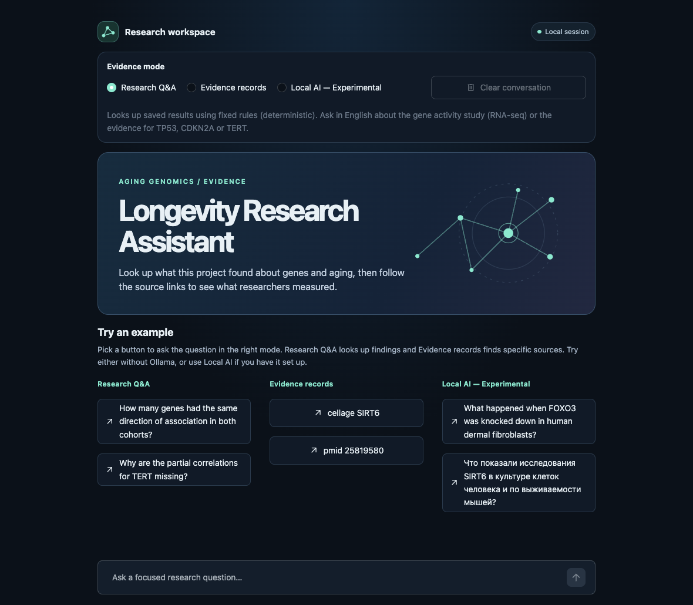

# Try the research assistant

The assistant opens in a browser on your own computer. There is currently no public online demo. You can start with Research Q&A and Evidence records. These modes use fixed rules and the project's saved results. They work without Ollama, a model download or the original research datasets.

## 1. Start the assistant

These commands use Terminal on macOS. Install Python 3.11 or newer and a web browser. Use Git if you want to clone the project. You need internet access to download the project and install the app's Python packages. [Python downloads](https://www.python.org/downloads/) · [Project on GitHub](https://github.com/Nikikikl/ai-longevity-research)

Clone the repository with Git.

```sh
git clone https://github.com/Nikikikl/ai-longevity-research.git
cd ai-longevity-research
```

Or choose **Code → Download ZIP** on GitHub, unzip it, and open Terminal in the extracted folder. Check that the folder contains `requirements-ui.txt` and `web_ui/`.

Run these commands from that folder. The first checks your Python version. The second creates a project-specific Python environment to keep its packages separate from other projects.

```sh
python3 --version
python3 -m venv .venv/ui
.venv/ui/bin/python -m pip install -r requirements-ui.txt
.venv/ui/bin/python -m streamlit run web_ui/app.py
```

Leave Terminal open. When it prints the local URL, open [http://127.0.0.1:8501](http://127.0.0.1:8501) in your browser. To stop the app, press **Ctrl+C** in Terminal. On your next visit, run only the last command from the project folder.

## 2. Try the two lookup modes

On the welcome screen, click an example button. It chooses the mode and sends the question for you. You can also select a mode and type the example yourself.



| Mode | Paste this | What to look for |
| --- | --- | --- |
| Research Q&A | `How many genes had the same direction of association in both cohorts?` | The relationship with age pointed in the same direction for 63 of 109 genes. A cohort is a group of people in a study. |
| Research Q&A | `Why are the partial correlations for TERT missing?` | **Not measured**. TERT's gene activity data did not meet the test's requirements in either group. The study did not estimate the correlations. |
| Evidence records | `cellage SIRT6` | The CellAge record for SIRT6. Read **Limitations** to see where the database label goes beyond what the experiment establishes. |
| Evidence records | `pmid 25819580` | Project records that cite the paper with this PubMed ID, with links to the source. |

Use the links under **Sources** to follow an answer's references. Read **Limitations** for the study's boundaries. **Evidence details** and **Technical details · JSON** contain record locations and structured fields. Use **Clear conversation** to reset the chat. The two lookup modes treat each question separately.

## 3. Add Local AI (optional)

The tested setup is an Apple M2 Mac with 8 GB of RAM, Python 3.11 and Ollama 0.40.15. For this macOS setup, use macOS 14 or newer. Allow about 1.4 GB for the `qwen3:1.7b` model, in addition to the app and Python environment. [Ollama macOS requirements](https://docs.ollama.com/macos) · [Model download size](https://ollama.com/library/qwen3:1.7b)

1. Download Ollama and move the app to **Applications**. If Ollama is running, quit it before starting the local server below. [Download Ollama for macOS](https://ollama.com/download/mac)
2. Open a separate Terminal window and run the server with cloud features disabled. Keep that window open.

   ```sh
   OLLAMA_HOST=127.0.0.1:11434 OLLAMA_NO_CLOUD=1 /Applications/Ollama.app/Contents/Resources/ollama serve
   ```

3. In another Terminal window, download the model. Confirm that `ollama list` shows `qwen3:1.7b`.

   ```sh
   /Applications/Ollama.app/Contents/Resources/ollama pull qwen3:1.7b
   /Applications/Ollama.app/Contents/Resources/ollama list
   ```

4. Start Streamlit as in step 1 if it is not running. Choose **Local AI — Experimental** in the browser. Look for **Ollama connected · qwen3:1.7b available**.

Try the English or Russian example on the welcome screen. Choose **Clear conversation** if you want to start a fresh chat.

- `What happened when FOXO3 was knocked down in human dermal fibroblasts?` asks about an experiment that reduced FOXO3 in lab-grown human skin cells.
- `Что показали исследования SIRT6 в культуре клеток человека и по выживаемости мышей?` asks about two studies. Look for separate sources for the human cell experiment and mouse survival.

Open **Retrieved evidence** and compare the answer with the exact passages. Check which cells, organisms or people the study examined and what it measured. A valid citation can still accompany an unsupported claim. [Known limitations and live evaluation](phase8a_final_status.md#evaluation-and-limitations)

Local AI shows up to six recent turns and can use the previous two questions to interpret a follow-up. After installation and model download, it can generate answers and show excerpts offline without an API key or a paid service. Opening published source links requires internet access.

## Troubleshooting

| If you see… | Try this |
| --- | --- |
| `python3: command not found` or a version below 3.11 | Install Python 3.11 or newer, then open a new Terminal and check `python3 --version`. |
| `requirements-ui.txt` not found | Move into the extracted or cloned project folder. Run `ls` and check that `requirements-ui.txt` and `web_ui` appear. |
| The browser cannot open the app | Check that the Streamlit command is still running. Use the local URL printed in Terminal if port 8501 is already in use. |
| Ollama cannot connect or the model is unavailable | Check that the server window is open and `ollama list` shows the exact model name. Click **Check Ollama again** in the app. If the server reports that port 11434 is in use, quit any running Ollama app or server before restarting it with the command above. |
| **Unsupported question** or **Insufficient evidence** | Try a supported example in the selected mode. The app covers this project's results and a small set of reviewed studies. |
| Local AI withholds an answer | Read any retrieved passages the app displays. A withheld answer can mean the model did not provide usable citations. |

You can also use the deterministic lookups from a Terminal without installing Streamlit. [Command-line examples and verification](REPRODUCE.md#verify-the-evidence-audit-and-benchmarks)
