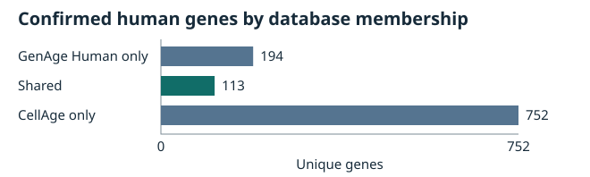

# Descriptive gene overlap

**113 uniquely validated human genes** are present in both HAGR exports.

## Confirmed gene sets

| Measure | Value |
| --- | ---: |
| Confirmed GenAge Human genes | 307 |
| Confirmed CellAge genes | 865 |
| Shared genes | 113 |
| GenAge Human only | 194 |
| CellAge only | 752 |
| Union | 1059 |
| Jaccard similarity (shared / union) | 0.106704 |
| GenAge Human genes represented in CellAge | 36.81% |
| CellAge genes represented in GenAge Human | 13.06% |

## Excluded CellAge record and sensitivity analysis

CellAge reports Gene ID `100529261` with source symbol `FNTB`. The Gene ID and source symbol point to different approved HGNC entries. The primary comparison excludes this mapping. The original evidence remains in `cellAge.zip` / `cellage3.tsv`, data record 290.

| Hypothetical assignment | Candidate from Phase 2 | In confirmed GenAge Human? | Shared genes |
| --- | --- | --- | ---: |
| Follow the source Gene ID | HGNC:42960 CHURC1-FNTB (Gene ID 100529261) | No | 113 |
| Follow the source symbol | HGNC:3785 FNTB (Gene ID 2342) | No | 113 |

The overlap remains **113** under either candidate. These assignments are sensitivity scenarios. The confirmed sets and the gene table use only the original confirmed mappings.

## Methods and traceability

- Verified SHA-256 `0a5691998d0d592774e96bb8f82e6654cae4a58789c6e76506fc348bb24dfcca` for `data/processed/gene_mapping.csv` against the [Phase 2 audit](gene_identifier_audit.md). The HAGR archive fingerprints are in the [data inventory](data_inventory.md).
- Matched confirmed, current human genes by Entrez Gene ID and required both approved HGNC ID and symbol to agree. The three disjoint groups sum to the union.
- The [shared gene table](gene_overlap_genes.csv) lists the original symbols and source ZIP members. Record numbers are JSON arrays of one-based data record ordinals, excluding the header and blank lines. Each shared gene appears once. CellAge record counts refer to experimental evidence associated with that gene.

## Scope

These counts describe membership in two curated database snapshots. GenAge Human includes evidence relevant to organismal aging, while CellAge captures gene manipulation evidence for cellular senescence. Membership reflects curation and available evidence. Causality and statistical significance are outside this descriptive comparison.
