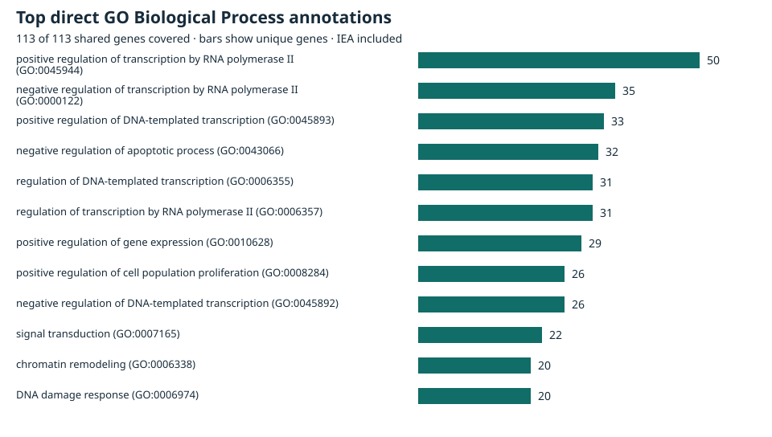

# Gene Ontology Biological Process annotations

Direct positive BP annotations were found for **113 of 113 shared human genes**.

## Identifier mapping and coverage

- 113 of 113 genes (100.00%) had at least one unambiguous HGNC UniProtKB cross-reference (114 distinct accessions).
- Genes with no HGNC UniProtKB cross-reference (0): None.
- Ambiguous accessions excluded (0): None.
- Genes without any unambiguous accession (0): None.
- Genes with multiple unambiguous accessions: CDKN2A (P42771, Q8N726).

| Positive BP annotation policy | Genes covered | Genes without coverage | Unique BP terms | GAF rows |
| --- | ---: | ---: | ---: | ---: |
| All eligible codes | 113 (100.00%) | 0 | 1805 | 6164 |
| Exclude IEA | 113 (100.00%) | 0 | 1532 | 4673 |

Genes without eligible positive BP coverage: None. After excluding IEA: None.

## Most frequently annotated direct terms

| GO ID | Biological process | Unique genes | Unique genes excluding IEA |
| --- | --- | ---: | ---: |
| GO:0045944 | positive regulation of transcription by RNA polymerase II | 50 | 49 |
| GO:0000122 | negative regulation of transcription by RNA polymerase II | 35 | 34 |
| GO:0045893 | positive regulation of DNA-templated transcription | 33 | 31 |
| GO:0043066 | negative regulation of apoptotic process | 32 | 24 |
| GO:0006355 | regulation of DNA-templated transcription | 31 | 15 |
| GO:0006357 | regulation of transcription by RNA polymerase II | 31 | 29 |
| GO:0010628 | positive regulation of gene expression | 29 | 24 |
| GO:0008284 | positive regulation of cell population proliferation | 26 | 21 |
| GO:0045892 | negative regulation of DNA-templated transcription | 26 | 24 |
| GO:0007165 | signal transduction | 22 | 17 |
| GO:0006338 | chromatin remodeling | 20 | 12 |
| GO:0006974 | DNA damage response | 20 | 19 |

## Evidence and filters

The distribution counts eligible positive GAF rows. Multiple rows can support the same gene–term pair and can cite the same study.

| Evidence category | Positive rows | Share | Evidence codes and row counts |
| --- | ---: | ---: | --- |
| Author statement | 603 | 9.78% | NAS 223, TAS 380 |
| Computational | 687 | 11.15% | ISS 687 |
| Curatorial statement | 26 | 0.42% | IC 26 |
| Electronic | 1491 | 24.19% | IEA 1491 |
| Experimental | 3045 | 49.40% | EXP 7, HDA 2, IDA 1897, IEP 31, IGI 138, IMP 964, IPI 6 |
| Phylogenetic | 312 | 5.06% | IBA 312 |

The annotation CSV also retains excluded rows: 7 with NOT, 0 with ND, 0 root annotations, and 0 without a resolvable active BP term. These status counts are mutually exclusive.

- Joined exact GAF UniProtKB object accessions to the pinned complete-set HGNC cross-references. Validated each HGNC entry against the overlap Entrez ID and approved symbol. Checked accession ownership against all approved HGNC entries. Gene symbols and isoform suffixes were never used to create mappings. The RNAcentral and ComplexPortal namespaces are outside this protein mapping.
- Kept GAF aspect P and primary taxon 9606. Counted direct positive annotations to active BP terms. Recognized alternate GO IDs using the same ontology, excluded the BP root GO:0008150 and ND from coverage, and kept NOT as a separate status. No ancestor propagation was applied.
- Ranked terms by distinct genes, with ties sorted by GO ID. Multiple proteins or evidence rows for a gene count once per term. Non-IEA includes phylogenetic, computational, author, and curator evidence as well as experimental evidence. See the [GO evidence guide](https://geneontology.org/docs/guide-go-evidence-codes/).

## Provenance and outputs

Gene Ontology Consortium data from [archive release 2026-08-05](https://release.geneontology.org/), © Gene Ontology Consortium, [CC BY 4.0](https://creativecommons.org/licenses/by/4.0/). This project filtered and joined the source annotations and aggregated them into derived tables and a figure. GO data are provided as-is under the [GO citation, license and warranty policy](https://geneontology.org/docs/go-citation-policy/). For publication cite [Ashburner et al.](https://doi.org/10.1038/75556) and [The Gene Ontology Consortium](https://doi.org/10.1093/nar/gkaf1292).

| Input | Version metadata | Retrieved (UTC) | Bytes | SHA-256 |
| --- | --- | --- | ---: | --- |
| [HUMAN-uniprot.gaf.gz](https://release.geneontology.org/2026-08-05/annotations/gaf/HUMAN-uniprot.gaf.gz) | gaf-version `2.2` generated-by `UniProt` date-generated `2026-07-28 19:42` go-version `http://purl.obolibrary.org/obo/go/releases/2026-07-26/extensions/go-plus.ofn` | 2026-11-08T09:17:40Z | 12,109,254 | `a0afba19dfb1f8fa996bc1bdcd61fd0c9bd4cf0d2bf2509d09ac86993c0e70a2` |
| [go-basic.obo](https://release.geneontology.org/2026-08-05/ontology/go-basic.obo) | format-version `1.2` data-version `releases/2026-07-26` | 2026-11-08T09:17:43Z | 32,227,785 | `b08d45b268b8c24ccb2513dbbbc7d4df9f6521c099b413f79eb31e06e0fa3bcc` |

The [Phase 3 shared-gene table](gene_overlap_genes.csv) has SHA-256 `01f208e99cbeb5f38369005c537dc86d5bf59d2fcbf04fea1faee5b6f82db11a`. HGNC mapping provenance is in the [Phase 2 manifest](../data/reference_provenance.json). The [GO manifest](../data/go_provenance.json) pins the exact source bytes and file metadata.

The [annotation CSV](go_gene_annotations.csv) preserves the original GO identifier, UniProtKB accession, reference, evidence, relation, date, and assigned-by source. Its `gaf_line` is the one-based line number in the decompressed GAF, including headers. The [term summary](go_process_summary.csv) gives unique-gene counts for both evidence policies.

## Interpretation

Coverage depends on the pinned annotation release, the HGNC–UniProtKB cross-references, and the curation available for each gene and context. Publication and annotation bias favor extensively studied genes and processes. These ranks describe annotation frequency within the selected genes. Enrichment would require a justified reference universe and an explicit test. Annotation evidence describes gene-product associations with processes. Effects of interventions on human lifespan remain a separate empirical question.
