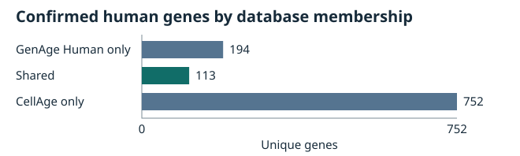
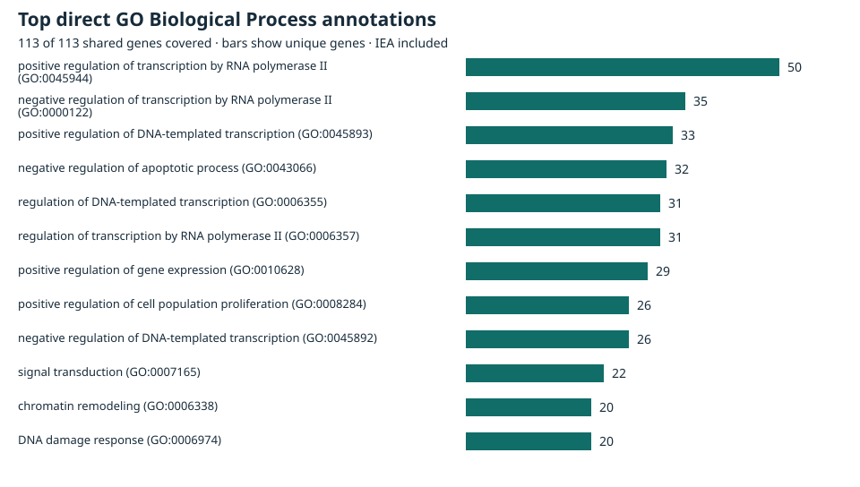

# A Reproducible Comparative Analysis of Human Aging and Cellular Senescence Genes

Version 1 · Research report for academic feedback · 2026-11-08

## Abstract

We compared two curated human gene sets from the Human Ageing Genomic Resources (HAGR) to describe where evidence relevant to aging and cellular senescence overlaps. After validating gene identifiers against pinned NCBI Gene and HGNC snapshots, we found 113 shared genes among 307 confirmed GenAge Human genes and 865 confirmed CellAge genes (Jaccard similarity 0.106704). The shared genes accounted for 125 CellAge records. All 113 had direct positive Gene Ontology Biological Process annotations. The number of distinct terms fell from 1,805 to 1,532 after excluding electronic annotations, with gene coverage unchanged. Primary studies of TP53, CDKN2A and TERT illustrate how the effect of a perturbation depends on the protein, cell model and endpoint. The study describes curated evidence and its provenance. It does not estimate effects on human lifespan.

## Introduction

Cellular senescence is a state of sustained proliferative arrest that can arise after several types of stress. It is relevant to organismal aging, but a senescence phenotype measured in culture and a change in organismal survival are different endpoints. GenAge Human curates human candidate genes using evidence that can include model-organism studies. CellAge curates perturbation evidence on cellular senescence in human cells. Comparing their membership identifies where the two resources converge and makes it possible to trace selected claims back to experiments. [1–4]

## Research Question and Objectives

Which validated human genes occur in both GenAge Human and CellAge, and which biological processes have direct annotations for those genes?

1. Resolve source identifiers and quantify the intersection, the source-specific sets and the union.
2. Describe direct Biological Process annotations and compare coverage with and without electronically inferred annotations (IEA).
3. Review the primary evidence behind three shared genes and distinguish the curated labels from the findings the cited experiments support.

## Data Sources and Methods

| Input | Pinned release or file version |
| --- | --- |
| HAGR GenAge Human, `human_genes.zip` / `genage_human.csv` | Build 21, released 2023-08-28 |
| HAGR CellAge gene manipulations, `cellAge.zip` / `cellage3.tsv` | Build 3, released 2023-04-23 |
| HGNC complete set, `hgnc_complete_set_2026-10-06.tsv` | Quarterly snapshot dated 2026-10-06 |
| NCBI Gene, `Homo_sapiens.gene_info.gz` | Rolling daily export captured with HTTP Last-Modified 2026-11-07T08:31:40Z |
| Gene Ontology (GO), `HUMAN-uniprot.gaf.gz` and `go-basic.obo` | Archive release 2026-08-05. The ontology data version is `releases/2026-07-26`. The UniProt GAF 2.2 header records generation on 2026-07-28 at 19:42 and refers to the 2026-07-26 GO version. |

We verified the archived bytes and checked the HAGR build dates against the release notes inside each ZIP. Retrieval timestamps and SHA-256 checksums are recorded separately from release dates. The CellAge expression-signature dataset is outside the study. [Source inventory](data_inventory.md), [HGNC and NCBI Gene manifest](../data/reference_provenance.json), [GO manifest](../data/go_provenance.json)

**Identifier harmonization and overlap.** We required a current human NCBI Gene ID (taxon 9606), a unique reciprocal match to an approved HGNC entry, and a source symbol consistent with that entry’s approved symbol, previous symbols or aliases. An approved symbol belonging to a different gene counted as a conflict. We grouped records by source Gene ID, then intersected the confirmed sets by Gene ID and checked agreement of the approved HGNC ID and symbol. We calculated Jaccard similarity as intersection size divided by union size. The gene table retains one-based source record ordinals, excluding headers and blank lines. [Identifier audit](gene_identifier_audit.md), [Overlap methods](gene_overlap.md)

**GO annotation.** We matched exact UniProtKB accessions from the pinned HGNC cross-references to the human GO Annotation File (GAF). We kept records with Biological Process (BP) aspect and primary taxon 9606. The summary uses direct, non-negated annotations to active BP terms, resolves alternate GO IDs, and excludes the BP root, records marked No Biological Data available (ND) and unresolved terms. We did not propagate annotations to ancestor terms. For each term we counted distinct genes, regardless of how many proteins or annotations mapped to that gene. The IEA exclusion checks sensitivity to one evidence class. The remaining annotations include experimental, computational, phylogenetic and statement-based evidence. [5, 6] [GO methods and evidence filters](go_biological_processes.md)

**Case studies.** For TP53, CDKN2A and TERT we traced every CellAge record to its source row and cited paper, then examined selected GO references for experimental context. Phase 5A checked bibliographic records for 43 distinct publications by PMID, DOI, title and year. The review used full text, publisher methods and results, or abstracts where available for the experimental claims it discusses. Some citations received bibliographic checks only. The matrix records the depth for each citation, and repeated PMIDs do not count as independent studies. [Case-study methods](gene_case_studies.md), [Evidence matrix](gene_evidence_matrix.csv)

## Results

### Overlap between the confirmed gene sets

| Measure | Count or value |
| --- | ---: |
| Confirmed GenAge Human genes | 307 |
| Confirmed CellAge genes | 865 |
| Shared genes | 113 |
| GenAge Human only | 194 |
| CellAge only | 752 |
| Union | 1,059 |
| Jaccard similarity | 0.106704 |
| CellAge evidence records associated with shared genes | 125 |



*Figure 1. Unique confirmed genes by database membership.*

CellAge contained 949 records and 866 source Gene IDs before harmonization. Record 290 gives Gene ID 100529261, which identifies CHURC1-FNTB (HGNC:42960), alongside the source symbol FNTB, which identifies Gene ID 2342 (HGNC:3785). We excluded the unresolved mapping. Neither candidate is in the confirmed GenAge Human set, so either hypothetical assignment leaves the shared count at 113. The 125 CellAge records linked to shared genes can include repeated publications. [Identifier audit](gene_identifier_audit.md), [Overlap gene table](gene_overlap_genes.csv)

### Direct GO Biological Process annotations

All 113 shared genes had unambiguous HGNC protein cross-references, with 114 distinct accessions because CDKN2A mapped to two products. All genes retained at least one direct positive BP annotation under both evidence policies.

| Evidence policy | Shared genes covered | Distinct BP terms | Eligible GAF rows |
| --- | ---: | ---: | ---: |
| All eligible codes | 113/113 | 1,805 | 6,164 |
| Excluding IEA | 113/113 | 1,532 | 4,673 |



*Figure 2. Frequent direct GO BP annotations among the shared genes. Bars count genes per term with IEA included. GO archive release 2026-08-05, © Gene Ontology Consortium, CC BY 4.0.*

The most frequent direct term was positive regulation of transcription by RNA polymerase II (GO:0045944, 50 genes). DNA damage response (GO:0006974) had 20 genes, or 19 after excluding IEA. These counts describe coverage in the selected set. [Annotation table](go_gene_annotations.csv), [Term summary](go_process_summary.csv), [GO license](https://creativecommons.org/licenses/by/4.0/)

### Primary evidence for three shared genes

**TP53.** p53 is a transcription factor that mediates damage-responsive checkpoints. The pinned GO data link p53 (P04637) to DNA damage response (GO:0006974, IDA and IMP) and replicative senescence (GO:0090399, IMP). CellAge records 870–872 all cite Sugrue et al. Restoring wild-type p53 expression in EJ human bladder carcinoma cells lacking functional p53 caused durable growth arrest and senescence-associated β-galactosidase (SA-β-gal) staining. The study did not demonstrate separate replicative, stress-induced and oncogene-induced pathways for those three records. In a distinct experiment, p53 knockdown let human MRC5 fibroblasts proliferate beyond the control replicative arrest. [7, 8]

**CDKN2A.** The locus encodes p16^INK4A, which restricts CDK4/6 activity and RB phosphorylation, and p14^ARF, which regulates p53 through MDM2. The pinned GO data assign cellular senescence (GO:0090398) to both p16 (P42771) and p14^ARF (Q8N726), with separate IMP citations. The three CellAge records (152–154) cite Kato et al., who delivered a p16 fusion protein to normal human TIG-3 fibroblasts. They observed G1 arrest, reduced RB phosphorylation and SA-β-gal staining. Arrest and staining persisted after washout. This reproduces features of replicative senescence. The cited experiments did not test the separately labeled stress-induced and oncogene-induced contexts. In an independent study, p16 knockdown temporarily delayed replicative arrest in human fibroblasts. A separate study of p14^ARF found p53-dependent arrest in hTERT-immortalized human mammary epithelial cells. [9–11]

**TERT.** TERT is the catalytic subunit of telomerase. CellAge record 845 cites Bodnar et al., who expressed hTERT in initially telomerase-negative human retinal pigment epithelial cells and foreskin fibroblasts. Telomerase-active clones generally maintained or lengthened telomeres, showed less SA-β-gal staining and continued dividing beyond the controls. The pinned GO rows for telomere maintenance via telomerase (GO:0007004) and replicative senescence (GO:0090399) both cite this same study with IMP. A separate GO row for telomere maintenance via recombination (GO:0000722, NAS) cites Egan and Collins. Their study characterized telomerase holoenzyme assembly and did not directly establish TERT-mediated recombination. The evidence matrix preserves the annotation with that qualification. [12, 13]

## Discussion

The intersection identifies human genes with evidence relevant to both aging and experimentally studied cellular senescence. Broad transcriptional terms and processes such as DNA damage response appear among the shared genes. The case studies illustrate two distinct ways to alter proliferation. p53 restoration and p16 delivery induced arrest in their respective models. hTERT expression prolonged proliferation where telomere attrition limited growth. These experiments make the overlap biologically interpretable without treating all shared genes as acting through one pathway.

CellAge summarizes perturbations and phenotypes. GO assigns gene products to processes with evidence codes and references. One study can support several records or appear in both resources, as for TERT. A human annotation can also cite a non-human model. For example, reducing `Trp53` dosage extended survival in severely short-lived `Sirt6`-null mice. That is an organism-level result in a specific genetic background, separate from p53-induced arrest in human cell culture. None of the case studies establishes an effect on human lifespan. [7, 12, 14]

## Limitations

- Both gene sets reflect curation rules, publication bias and the chosen snapshots. The overlap does not establish causality, and absence from either set does not rule out a biological role.
- GO term frequencies depend on annotation depth, identifier coverage and evidence policy. The study did not use a background universe or statistical enrichment tests. No machine-learning model was trained.
- The three cases illustrate evidence interpretation. They do not represent a systematic review of all shared genes or all 125 CellAge records. Bibliographic verification did not include full-text examination of all 43 publications.
- Cell type, perturbation and endpoint constrain each causal claim. Culture growth arrest, continued population doublings and senescence markers do not measure organismal aging or human survival.

## Conclusion

The pinned comparison identifies 113 confirmed genes shared between GenAge Human and CellAge. All retain direct BP coverage after IEA exclusion, though the term set narrows. The three case studies show why interpretation requires the original perturbation, model and endpoint alongside the database labels. The resulting gene and annotation tables provide a traceable basis for academic review of these descriptive findings.

## Data Availability and Reproducibility

The repository includes the scripts, derived results and checksums. The raw archives, raw reference files and generated identifier mapping are outside Git. Obtain the exact inputs using the manifest URLs and filenames. Put the HAGR ZIPs in `data/raw/` and the HGNC, NCBI Gene and GO files in `data/raw/references/`. Retain byte-identical copies. The NCBI Gene URL changes in place, and HAGR stable URLs can serve newer builds. Once a provider replaces the bytes at a URL, exact reproduction depends on a retained copy or access to the original snapshot. [GenAge Human manifest](../data/raw/human_genes.zip.json), [CellAge manifest](../data/raw/cellAge.zip.json), [HGNC and NCBI Gene manifest](../data/reference_provenance.json), [GO manifest](../data/go_provenance.json)

Run from the repository root with Python 3.11 or newer. The workflow uses the standard library.

```sh
python3 -B -m scripts.download_data
python3 -B -m scripts.inspect_data
python3 -B -m scripts.harmonize_genes
python3 -B -m scripts.analyze_overlap
python3 -B -m scripts.annotate_go
python3 -B -m unittest discover -s tests -v
```

After generating the mapping, use `--check` with `harmonize_genes`, `analyze_overlap` and `annotate_go` to compare regenerated outputs without writing. The literature review is a manual evidence assessment. Its traceable inputs are the published articles, CellAge ordinals and GAF line numbers. [Overlap gene table](gene_overlap_genes.csv), [GO annotations](go_gene_annotations.csv), [Case studies](gene_case_studies.md), [Evidence matrix](gene_evidence_matrix.csv)

## References

1. de Magalhães JP et al. Human Ageing Genomic Resources: updates on key databases in ageing research. *Nucleic Acids Res.* 2024. [DOI 10.1093/nar/gkad927](https://doi.org/10.1093/nar/gkad927), [PMID 37933854](https://pubmed.ncbi.nlm.nih.gov/37933854/).
2. Tacutu R et al. Human Ageing Genomic Resources: new and updated databases. *Nucleic Acids Res.* 2018. [DOI 10.1093/nar/gkx1042](https://doi.org/10.1093/nar/gkx1042), [PMID 29121237](https://pubmed.ncbi.nlm.nih.gov/29121237/).
3. Avelar RA et al. A multidimensional systems biology analysis of cellular senescence in aging and disease. *Genome Biol.* 2020. [DOI 10.1186/s13059-020-01990-9](https://doi.org/10.1186/s13059-020-01990-9), [PMID 32264951](https://pubmed.ncbi.nlm.nih.gov/32264951/).
4. López-Otín C et al. Hallmarks of aging: An expanding universe. *Cell.* 2023. Review. [DOI 10.1016/j.cell.2022.11.001](https://doi.org/10.1016/j.cell.2022.11.001), [PMID 36599349](https://pubmed.ncbi.nlm.nih.gov/36599349/).
5. Ashburner M et al. Gene ontology: tool for the unification of biology. *Nat Genet.* 2000. [DOI 10.1038/75556](https://doi.org/10.1038/75556), [PMID 10802651](https://pubmed.ncbi.nlm.nih.gov/10802651/).
6. Gene Ontology Consortium. The Gene Ontology knowledgebase in 2026. *Nucleic Acids Res.* 2026. [DOI 10.1093/nar/gkaf1292](https://doi.org/10.1093/nar/gkaf1292), [PMID 41413728](https://pubmed.ncbi.nlm.nih.gov/41413728/).
7. Sugrue MM et al. Wild-type p53 triggers a rapid senescence program in human tumor cells lacking functional p53. *Proc Natl Acad Sci USA.* 1997. [DOI 10.1073/pnas.94.18.9648](https://doi.org/10.1073/pnas.94.18.9648), [PMID 9275177](https://pubmed.ncbi.nlm.nih.gov/9275177/).
8. Binet R et al. WNT16B is a new marker of cellular senescence that regulates p53 activity and the phosphoinositide 3-kinase/AKT pathway. *Cancer Res.* 2009. [DOI 10.1158/0008-5472.CAN-09-1016](https://doi.org/10.1158/0008-5472.CAN-09-1016), [PMID 19951988](https://pubmed.ncbi.nlm.nih.gov/19951988/).
9. Kato D et al. Features of replicative senescence induced by direct addition of antennapedia-p16INK4A fusion protein to human diploid fibroblasts. *FEBS Lett.* 1998. [DOI 10.1016/S0014-5793(98)00426-8](https://doi.org/10.1016/S0014-5793%2898%2900426-8), [PMID 9607312](https://pubmed.ncbi.nlm.nih.gov/9607312/).
10. Bond J et al. Direct evidence from siRNA-directed “knock down” that p16(INK4a) is required for human fibroblast senescence and for limiting ras-induced epithelial cell proliferation. *Exp Cell Res.* 2004. [DOI 10.1016/j.yexcr.2003.09.021](https://doi.org/10.1016/j.yexcr.2003.09.021), [PMID 14720514](https://pubmed.ncbi.nlm.nih.gov/14720514/).
11. Shamanin VA and Androphy EJ. Immortalization of human mammary epithelial cells is associated with inactivation of the p14ARF-p53 pathway. *Mol Cell Biol.* 2004. [DOI 10.1128/MCB.24.5.2144-2152.2004](https://doi.org/10.1128/MCB.24.5.2144-2152.2004), [PMID 14966292](https://pubmed.ncbi.nlm.nih.gov/14966292/).
12. Bodnar AG et al. Extension of life-span by introduction of telomerase into normal human cells. *Science.* 1998. [DOI 10.1126/science.279.5349.349](https://doi.org/10.1126/science.279.5349.349), [PMID 9454332](https://pubmed.ncbi.nlm.nih.gov/9454332/).
13. Egan ED and Collins K. Specificity and stoichiometry of subunit interactions in the human telomerase holoenzyme assembled in vivo. *Mol Cell Biol.* 2010. [DOI 10.1128/MCB.00151-10](https://doi.org/10.1128/MCB.00151-10), [PMID 20351177](https://pubmed.ncbi.nlm.nih.gov/20351177/).
14. Ghosh S et al. Haploinsufficiency of *Trp53* dramatically extends the lifespan of *Sirt6*-deficient mice. *eLife.* 2018. [DOI 10.7554/eLife.32127](https://doi.org/10.7554/eLife.32127), [PMID 29474172](https://pubmed.ncbi.nlm.nih.gov/29474172/).
