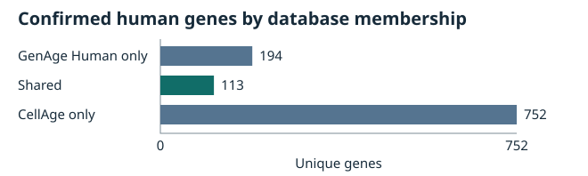

# Evidence and reproducibility in human aging and cellular senescence

Experimental v2.0.0 · Consolidated research report · 2026-11-08

## Summary

The pinned GenAge–CellAge comparison yielded 113 shared human genes, matching a previously published count. The exploratory RNA-seq analysis found that the fixed panel did not outperform expression-matched controls on the prespecified cross-cohort age-association comparison. Within discovery, Ridge regression predicted donor chronological age better than constant predictors, with error typical of matched panels. The evidence audit traced selected claims for five genes back to their original records and measurements. A deterministic lookup improved from 5/24 to 18/24 exact answers on a small held-out set after terminology normalization. The release documents a reproducible comparison, an exploratory negative result and a way to inspect the evidence behind curated claims.

## GenAge–CellAge overlap and prior art

GenAge Human Build 21 supplies aging-associated candidates, including genes supported by model-organism work. CellAge Build 3 supplies records of perturbations linked to cellular senescence in human cells. We required a current human NCBI Gene ID, reciprocal HGNC agreement and a compatible source symbol. The intersection contains **113 genes** among 307 confirmed GenAge genes and 865 confirmed CellAge genes. The union contains 1,059 genes (Jaccard similarity 0.106704). The 125 CellAge records for the shared genes include repeated publications. The unresolved FNTB / CHURC1-FNTB record was excluded. Neither candidate assignment changes the overlap count. [Version 1 report](research_report_v1.md) · [Identifier audit](gene_identifier_audit.md) · [Shared-gene table](gene_overlap_genes.csv)

Bonnefous et al. reported the same count in an evolutionary network analysis, with 303 exploitable GenAge genes and 852 exploitable CellAge genes. Their protein and orthology eligibility differs from our gene identifier rules. The published HAGR build labels appear transposed, and the available supplements lack the gene lists needed to verify membership equivalence. The contribution here is the traceable workflow and evidence analysis for identified snapshots. [Bonnefous et al.](https://doi.org/10.1007/s11357-024-01234-9) · [Prior-art comparison](../docs/related_work.md#bonnefous-et-al-2024)

All 113 genes retain a direct, positive GO Biological Process annotation after excluding electronically inferred annotations (IEA). The number of distinct terms decreases from 1,805 to 1,532. These are descriptive counts of annotations under two evidence policies. The remaining evidence codes include curated inferences and statements alongside experimental evidence. [GO methods and results](go_biological_processes.md) · [Figure by unique gene count](go_biological_processes.svg)

## Phase 7A · Exploratory RNA-seq analysis

The protocol tested whether the fixed 113-gene panel carried a stronger reproducible donor-age expression signal than matched genes outside the panel. Discovery used GSE113957 (97 eligible healthy donors) and validation used GSE226189 (82), with a common age range of 22–89. After identifier mapping and expression filtering, 109 panel genes were eligible in both cohorts. The analysis estimated partial Pearson correlations separately on log-transformed FPKM and counts per million, adjusting for sex in both cohorts and sequencing platform in discovery. [Frozen protocol](../docs/phase7_research_protocol.md) · [Fleischer et al.](https://doi.org/10.1186/s13059-018-1599-6) · [Tsitsipatis et al.](https://doi.org/10.1111/acel.13915)

The mean product of discovery and validation partial correlations was **0.00464** for the panel and **0.00685** at the median of 1,000 panels matched on expression abundance and detection in both cohorts. The target fell below the matched 95th-percentile cutoff of 0.01034. The 95% donor-bootstrap interval was −0.01143 to 0.02270 and the one-sided validation permutation p-value was 0.2889. The prespecified decision rule was unmet. Signs agreed for 63/109 genes, and none passed q < 0.05 in both cohorts with concordant signs. The matched reference describes the observed comparison, with approximate matching and no guarantee of comparable co-expression. [Association results](phase7_baseline_results.md#independent-association-analysis) · [Gene-level estimates and eligibility](phase7_gene_associations.csv)

In five-fold discovery cross-validation, feature filtering and scaling used training donors only. Ridge reached **15.34 years MAE**, versus 20.18 for the training mean, 20.38 for the training median and 15.03 at the median of 40 matched Ridge comparators. The panel outperformed 12 of 40 matched comparators. This demonstrates some chronological-age information within discovery under the specified evaluation. Prediction error in an external cohort remains unknown. Differences in quantification, sample composition, culture and incomplete technical metadata limit interpretation of the cross-cohort result. [Prediction results](phase7_baseline_results.md#discovery-prediction-feasibility) · [Cohort and data audit](phase7_data_feasibility.md)

## Phase 7B · Evidence integrity

The original audit indexes 73 records for TP53, CDKN2A and TERT. The 60 rows with publication citations point to 43 distinct PMIDs, with 11 PMIDs reused across 28 rows. Three TP53 CellAge records cite one p53 restoration experiment in EJ carcinoma cells. Three CDKN2A records cite one p16 delivery study in early-passage human fibroblasts. One TERT CellAge record and two GO rows cite the same hTERT culture study. Separate annotations may refer to distinct endpoints within one paper, and different PMIDs alone cannot establish experimental independence. [Original case studies](gene_case_studies.md) · [Evidence audit](phase7b_evidence_audit.md) · [Phase 7B ledger](phase7b_evidence_ledger.csv)

The underlying experiments support specific cell outcomes. Restoring p53 and delivering p16 induced senescence phenotypes in their respective models, while hTERT expression delayed replicative senescence in cultured human cells. One TERT GO annotation cites a study of telomerase assembly for telomere maintenance via recombination, a mechanism the cited experiments did not directly demonstrate. Review depth varies by paper and includes bibliographic checks, abstracts and full text. [Egan and Collins](https://pubmed.ncbi.nlm.nih.gov/20351177/) · [Review depth and primary references](gene_case_studies.md#traceability-and-interpretation-rules)

## Phase 7C · Deterministic assistant evaluation

The lookup returns structured facts, source IDs, evidence type and a status that can express missing measurements or insufficient evidence. Phase 7B's **21/22** is a development-set score. Phase 7C fixed 32 additional prompts and references before changing the lookup, used eight for development and reserved 24 for final comparison. The candidate normalized terminology and retained the same evidence and scorer. [Phase 7B benchmark](phase7b_benchmark_results.md) · [Phase 7C evaluation protocol](../docs/phase7c_evaluation_protocol.md)

| Evaluation | Original lookup | Normalized lookup |
| --- | ---: | ---: |
| Phase 7C development exact answers | 1/8 | 7/8 |
| Phase 7C held-out exact answers | 5/24 | 18/24 |
| Held-out exact citation matches | 5/24 | 18/24 |
| Held-out evidence type | 9/24 | 21/24 |
| Held-out correct abstentions | 2/10 | 6/10 |
| Held-out false abstentions on answerable prompts | 11/14 | 2/14 |

All six remaining held-out misses were generic abstentions, including compound questions requiring evidence from several sources. Manual inspection identified zero responses with unsupported assertions in either held-out run. The questions share topics and evidence, and the question author also implemented the candidate. The final prompts were held out from debugging and evaluation feedback. They characterize transfer to unfamiliar wording in this corpus, with no independent reviewer or evaluation on new evidence. [Phase 7C results](phase7c_results.md) · [Frozen prompts](../benchmarks/phase7c_questions.json)

## Phase 7D · FOXO3 and SIRT6

The extension adds eight source rows for FOXO3 and SIRT6, bringing the two ledgers to 81 rows and 46 distinct PMIDs. The two archived GenAge rows give inclusion categories. The CellAge and selected GO rows connect curated claims to primary references. [Extension ledger](phase7d_evidence_ledger.csv) · [Case studies](phase7d_case_studies.md)

- **FOXO3.** CellAge 296 is supported at abstract depth by increased senescence markers after FOXO3 depletion in cultured dermal fibroblasts. The specific subtype remains unclear. A separate study linked FOXO3 genotype to exceptional longevity in Japanese American men using an observational case-control design. The Phase 7A RNA estimates changed sign (+0.159 and −0.079), with neither passing q < 0.05. [Kim et al.](https://pubmed.ncbi.nlm.nih.gov/15741276/) · [Willcox et al.](https://pmc.ncbi.nlm.nih.gov/articles/PMC2544566/)
- **SIRT6.** The Nagai abstract and author’s methods summary support short-term senescence markers, reduced proliferation and more telomere damage foci after SIRT6 depletion in chondrocytes. Three CellAge and GO rows cite that study. The available methods leave the `Replicative` subtype and telomere length maintenance unestablished. A separate GO lifespan annotation cites an observational genotype association with age at death. Mouse experiments measured distinct survival and senescence endpoints in defined models. The Phase 7A estimates were −0.307 and −0.075, with q < 0.05 only in discovery. [Nagai et al.](https://pubmed.ncbi.nlm.nih.gov/25819580/) · [Methods summary](https://da.lib.kobe-u.ac.jp/da/kernel/D1006529/D1006529yy.pdf) · [TenNapel et al.](https://doi.org/10.1371/journal.pone.0115616) · [Mouse study and endpoint comparison](phase7d_case_studies.md#sirt6)

The gene-level RNA-seq estimates describe associations of fibroblast expression with donor chronological age. The intervention studies measure the effects of imposed changes and the human genotype studies measure survival-related associations. Those endpoints do not test the same hypothesis. All 10 new structured lookup checks passed, including one scoped abstention. These are development checks for the added records. [Phase 7D verification](phase7b_evidence_audit.md#phase-7d-extension)

## Open questions and proposed experiments

The project establishes the overlap and annotation counts for identified inputs and documents where particular claims can be traced to measured outcomes. The RNA-seq test is exploratory and leaves smaller or context-dependent age signals open. The five-gene audit cannot estimate the prevalence of curation discrepancies. The work supplies neither evidence of newly discovered longevity genes nor evidence that an intervention extends human lifespan.

Potential experiments include replication of the fixed-panel association test in an independent cohort with comparable gene quantification and measured culture covariates, and testing whether SIRT6 depletion changes serial population doublings and produces durable arrest after the perturbation ends. A separate evaluation with independently authored questions could test reasoning across sources. These are proposals outside the completed release. [RNA-seq limitations](phase7_baseline_results.md#interpretation-and-follow-up) · [SIRT6 evidence boundary](phase7d_case_studies.md#sirt6) · [Assistant evaluation limitations](phase7c_results.md#reproduction-and-decision)

## Reproducibility and sources

The release check verified file sizes and SHA-256 for all ten pinned source files available in the working copy. A separate export of the tracked tree rebuilt the identifier audit, verified the overlap and GO tables and both SVGs against their tracked versions, and reproduced the Phase 7A association CSV and aggregate metrics byte for byte. All 53 tests passed. The Phase 7B, 7C and 7D evaluations also ran from an export containing only tracked files, including a digest match for both held-out Phase 7C outputs.

| Source | Snapshot and manifest |
| --- | --- |
| HAGR | GenAge Human Build 21 (2023-08-28) and CellAge Build 3 (2023-04-23). [GenAge](../data/raw/human_genes.zip.json) · [CellAge](../data/raw/cellAge.zip.json) |
| Identifiers | HGNC quarterly complete set dated 2026-10-06 and NCBI Gene daily export with HTTP Last-Modified 2026-11-07T08:31:40Z. [Manifest](../data/reference_provenance.json) |
| GO | Archive release 2026-08-05, ontology data version 2026-07-26 and UniProt human GAF 2.2. [Manifest](../data/go_provenance.json) |
| GEO | Four submitted processed files from GSE113957 and GSE226189, retrieved 2026-11-08. [Manifest](../data/phase7_sources.json) · [RNA-seq environment and commands](phase7_data_feasibility.md#provenance-reuse-and-reproduction) |

Raw inputs are outside Git. Exact rebuilds require byte-identical copies. HAGR stable download URLs can change builds, and the NCBI Gene URL is updated in place. The earlier source check observed different bytes at the live NCBI URL. If the pinned snapshot cannot be obtained, its manifest can identify a replacement mismatch but cannot reconstruct the original file. Benchmark scoring and the checked-in derived results remain accessible from the repository. [Documented rolling-source limitation](../docs/related_work.md#contribution-and-limits) · [Reproduction entry points](../README.md#run-the-evidence-audit-and-qa)

The project attributes GenAge and CellAge to HAGR under CC BY 3.0 Unported and the derived GO annotations and figure to the Gene Ontology Consortium under CC BY 4.0. Cite the GEO accessions and originating papers for RNA-seq. GEO notes that submitters may assert rights in their data. [HAGR terms](https://genomics.senescence.info/legal.html) · [GO citation policy](https://geneontology.org/docs/go-citation-policy/) · [GEO disclaimer](https://www.ncbi.nlm.nih.gov/geo/info/disclaimer.html) · [Foundational references](research_report_v1.md#references)
